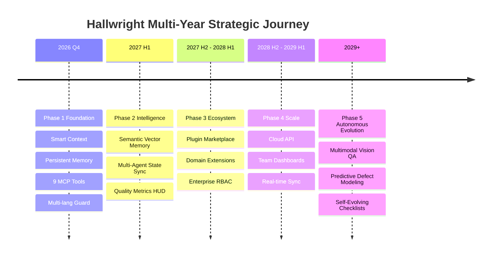

# 🗺️ HALLWRIGHT: Strategic Roadmap & Architecture Evolution (2026–2031)

> **Vision:** Universal AI Agent Quality & Intelligence Protocol — empowering developers and autonomous AI coding assistants (Claude Code, Cursor, Copilot, Antigravity, Windsurf, Kimi) with deterministic quality enforcement, persistent memory, and collective intelligence.

---

## 📊 Current State Analysis (SWOT)

### ✅ Strengths (Mavjud Kuchli Tomonlar)
- **64 Domain Expert Personas:** Specialized quality checklists spanning Architecture, Cybersecurity, SRE, Compilers, and Deep-Tech simulations.
- **8 Domain Guilds:** Modular squads with dynamic keyword & file-type routing (`SmartMasterSelector`), cutting token overhead from 12K to ~2K.
- **Persistent Learning Memory (`.artisan/memory.json` v2.0):** Automatic scar-tissue retention preventing agents from repeating past project mistakes.
- **Full Model Context Protocol (MCP) Server:** 9 standard JSON-RPC 2.0 tools with strict parameter schema validation.
- **Zero-Dependency Core:** Portable Python/JS engines running seamlessly on Linux, macOS, and Windows.
- **Pre-Commit Gatekeeper & CI Actions:** Deterministic gates blocking stubs, unhandled exceptions, and credential leaks.
- **14 AI Agent Ecosystem Modules:** Pre-configured rule packages for Cursor, Claude, Antigravity, Cline, Kimi, Windsurf, etc.

### ⚠️ Growth Areas (Rivojlantirish Kerak Bo'lgan Sohalar)
- **Semantic Vector Memory:** Upgrading keyword/tag matching to local vector embeddings (e.g. SQLite-VSS or Qdrant-lite).
- **Multi-Agent Cross-Talk:** Establishing live shared memory channels when multiple agents work simultaneously in the same repo.
- **Visual & Multimodal QA:** Headless browser DOM and visual capture for UI design system inspection.
- **Public Plugin Ecosystem:** Standardized schema for community-contributed custom personas and domain rules.

---

## 🚀 5-Phase Evolution Plan



---

## Phase 1: Foundation (Current Status: ~90% Implemented)
**Goal:** Core stability, deterministic quality enforcement, and zero-overhead agent integration.

- [x] **Smart Context Engine (`src/sdk/context_selector.py`):**
  - Keyword and file-extension heuristics routing tasks to relevant domain leads.
  - Token compression: 12,000 → ~1,800 tokens (85% context reduction).
- [x] **Agent Learning System (`src/sdk/learning_memory.py`):**
  - Persistent `.artisan/memory.json` v2.0 with deduplication and frequency weighting.
  - Autonomous recording of mistakes, anti-patterns, conventions, and remediation rules.
- [x] **Robust MCP Server (`mcp/server.py`):**
  - 9 standard tools (`select_masters`, `get_lessons`, `record_learning`, `inject_prompt`, `inspect_code`, etc.).
  - Strict JSON-RPC parameter schema validation (`-32602` error handling).
- [x] **Multi-Language Detection Guard (`scripts/detector.py`):**
  - Multi-line block stub scanner (`/* ... */`, `""" ... """`).
  - Safe placeholder filtering (`password = "test123"` false-positive elimination).
  - Multi-language structural checks (JS/TS, Go, Java, C#).
  - Graduated file-weighted scoring avoiding false-zero project ratings.
- [ ] **Developer Documentation & Quickstart:**
  - Interactive walkthroughs and real-world example guides.

---

## Phase 2: Intelligence & Multi-Agent Collaboration (2027 H1)
**Goal:** Cross-agent state sharing, semantic matching, and workspace intelligence.

### 2.1 Multi-Agent State Synchronization
- Coordinated workspace state when Claude Code, Cursor, and Antigravity edit the same repo.
- Lock-free memory synchronization via atomic append ledger.
- Cross-agent convention consensus mechanism.

### 2.2 Semantic Vector Memory
- Optional lightweight vector embedding engine (sentence-transformers or fast local ONNX).
- Semantic matching: Maps informal user requests (e.g. *"payment feels sluggish"*) directly to relevant database and async masters.

### 2.3 Workspace Quality Analytics
- Interactive CLI and web HUD displaying historical defect trends.
- ROI metrics: prevented regressions, eliminated stubs, and test coverage improvements.

---

## Phase 3: Plugin Ecosystem & Domain Extensions (2027 H2 – 2028 H1)
**Goal:** Community extensibility and enterprise team management.

### 3.1 Plugin SDK (`hallwright-plugin-*`)
- Standardized manifest (`hallwright-plugin.json`) allowing third parties to publish domain packs:
  - `hallwright-plugin-solidity`: Smart contract security & gas optimization.
  - `hallwright-plugin-godot`: GDScript & game physics invariants.
  - `hallwright-plugin-bioinformatics`: Genomic pipeline standards.
- Sandboxed execution and integrity verification.

### 3.2 Enterprise Governance
- Custom private guild definitions for corporate proprietary stacks.
- Centralized organization policy distribution via Git or secure registry.

---

## Phase 4: Cloud Infrastructure & Scaled Telemetry (2028 H2 – 2029 H1)
**Goal:** Centralized team intelligence, webhooks, and hosted MCP endpoints.

- **Hosted Cloud MCP:** Connect Claude, Cursor, or remote agents to team memory without local Python runtime.
- **CI/CD Cloud Gateway:** GitHub App & GitLab integration with automated PR review bots.
- **Enterprise Security:** SOC2 Type II compliance, zero customer code retention, and encrypted memory sync.

---

## Phase 5: Autonomous Evolution (2029+)
**Goal:** Predictive defect mitigation and multimodal visual evaluation.

- **Multimodal Visual QA:** Headless Chromium screenshot critique inspecting UI contrast, visual hierarchy, and 8pt token compliance directly from DOM pixels.
- **Predictive Quality Guard:** Machine learning models estimating regression risk per git commit before execution.
- **Self-Evolving Heuristics:** Heuristic checklists that automatically adjust thresholds based on team review feedback.

---

## 💼 Sustainable Open-Source & Monetization Model

```
┌────────────────────────────────────────────────────────────────────────┐
│                        HALLWRIGHT ECOSYSTEM TIERS                         │
├──────────────────────────┬──────────────────────────┬──────────────────┤
│ Free Community (Open)    │ Pro Developer            │ Enterprise Team  │
├──────────────────────────┼──────────────────────────┼──────────────────┤
│ • Local CLI & Hooks      │ • Cloud Memory Sync      │ • Private Guilds │
│ • 64 Council Personas    │ • Semantic Vector Search │ • SSO & RBAC     │
│ • Local MCP Server       │ • Multi-Agent State Sync │ • Compliance Log │
│ • Zero-Dependency Core   │ • Advanced Analytics HUD │ • Dedicated SLA  │
└──────────────────────────┴──────────────────────────┴──────────────────┘
```

---

*Authored as part of the Hallwright Autonomous Craftsmanship & Quality Protocol.*
